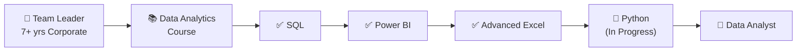
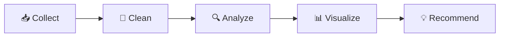

<!-- ═══════════════════════════════════════════════════════════
     GITHUB PROFILE README: Bharti Saini (BhartiSaini7)
     Repo name must be exactly: BhartiSaini7
     ═══════════════════════════════════════════════════════════ -->

<!-- ───────────── HEADER BANNER ───────────── -->
<div align="center">
  
</div>

<!-- ───────────── TYPING ANIMATION ───────────── -->
<div align="center">
  <a href="https://github.com/BhartiSaini7">
    
  </a>
</div>

<br/>

<!-- ───────────── BADGES ───────────── -->
<div align="center">

  <a href="https://github.com/BhartiSaini7"></a>
  
  

</div>

<br/>

<div align="center">

  <a href="https://www.linkedin.com/in/bharti-saini-a318bb2b2"></a>
  

</div>

<br/>

---

## 👋 About Me

```python
class DataAnalyst:
    def __init__(self):
        self.name = "Bharti Saini"
        self.location = "Gurgaon, India"
        self.background = "Team Leader | 7+ years in corporate"
        self.now = "Data Analytics (course + hands-on projects)"
        self.tools = ["SQL", "Power BI", "Advanced Excel"]
        self.learning = ["Python", "Pandas", "Data Visualization"]
        self.superpower = "Combining business sense with data skills"

    def mission(self):
        return "Help teams make faster, smarter decisions with data 📈"
```

> 💬 After 7+ years leading teams, meeting targets and reporting to stakeholders, I know what business decisions actually need. Now I'm building the technical skills to answer those questions with data.

<br/>

## 🧭 My Journey



<br/>

## 🛠️ Skills & Tools

<div align="center">


<br/><br/>


</div>

<br/>

## 🤝 What Leadership Adds to My Data Work

| Skill from 7+ years of leading teams | How it helps as an analyst |
|---|---|
| 🎯 Target and KPI ownership | I know which metrics matter and why |
| 🗣️ Stakeholder communication | I present insights in plain business language |
| 📋 Reporting and review cycles | I build dashboards people actually use |
| ⚙️ Process improvement | I look for the root cause behind a number |
| 👥 Team management | I work well with cross-functional teams |

<br/>

## 🔄 How I Work with Data

<div align="center">



</div>

<br/>

## 📁 Projects

> 🚧 Portfolio projects are being built as I learn. Each one will include the business problem, tools used, key insight and a link to the dashboard or notebook.

| Project | Problem | Tools | Status |
|---|---|---|---|
| 📈 Sales Performance Dashboard | Track revenue by region and product | Power BI, Excel | 🔜 Coming soon |
| 🗄️ SQL Customer Analysis | Segment customers and find top buyers | SQL | 🔜 Coming soon |
| 🐍 Data Cleaning & EDA | Clean a messy dataset and explore trends | Python, Pandas | 🔄 In progress |

<br/>

## 🎯 Learning Roadmap

- [x] SQL: queries, joins, aggregations
- [x] Power BI: dashboards and reports
- [x] Advanced Excel: formulas, pivot tables, analysis
- [ ] 🔄 Python: Pandas, NumPy *(in progress)*
- [ ] Data visualization with Matplotlib / Seaborn
- [ ] Statistics for data analysis
- [ ] Build and publish portfolio projects

<br/>

## 📊 GitHub Stats

<div align="center">

  
  

  <br/>

  

</div>

<br/>

## 🐍 Contribution Snake

<!-- Requires .github/workflows/snake.yml -->
<div align="center">
  <picture>
    <source media="(prefers-color-scheme: dark)" srcset="https://raw.githubusercontent.com/BhartiSaini7/BhartiSaini7/output/github-snake-dark.svg" />
    <source media="(prefers-color-scheme: light)" srcset="https://raw.githubusercontent.com/BhartiSaini7/BhartiSaini7/output/github-snake.svg" />
    
  </picture>
</div>

<br/>

## 📫 Let's Connect

<div align="center">

  <a href="https://www.linkedin.com/in/bharti-saini-a318bb2b2">
    
  </a>

  <br/><br/>

  <a href="https://www.linkedin.com/in/bharti-saini-a318bb2b2"></a>

  <br/><br/>

  <sub>⭐ Thanks for stopping by. Data tells stories, and I'm learning to tell them well.</sub>

</div>

<!-- ───────────── FOOTER WAVE ───────────── -->
<div align="center">
  
</div>

